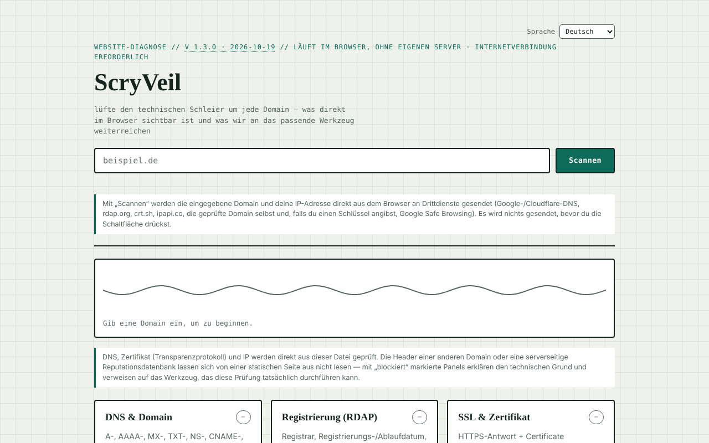

# ScryVeil

[English](README.md) · [Română](README.ro.md) · [Français](README.fr.md) · [Italiano](README.it.md) · [Español](README.es.md) · [Português](README.pt.md) · **Deutsch** · [Magyar](README.hu.md)

**Version:** 1.3.1 · **Zuletzt aktualisiert:** 2026-10-22

Oberflächensprachen: **Română, English, Français, Italiano, Español, Português (PT), Deutsch, Magyar**

Sicherheitsdiagnose für jede Website, direkt im Browser ausgeführt: DNS, RDAP, Zertifikat, Header, IP und Reputation.

**Online-App:** https://chiuta.github.io/ScryVeil/

## Was es ist

ScryVeil ist eine Ein-Datei-Anwendung (`index.html`), die den „technischen Schleier“ um eine Domain lüftet: Man gibt eine Domain ein, und die Seite führt im Browser alle Prüfungen aus, die ohne eigenen Server möglich sind. Was sich von einer statischen Seite aus nicht lesen lässt (die Header einer fremden Domain, serverseitige Reputationsdatenbanken), wird als „blockiert“ markiert, mit der technischen Erklärung und Links zu passenden externen Werkzeugen, wobei die Domain automatisch eingetragen wird.

## Funktionen

Sechs Bereiche:

- **DNS & Domain** — A-, AAAA-, MX-, TXT-, NS-, CNAME-, SOA-, CAA-Einträge und DNSSEC-Signal.
- **Registrierung (RDAP)** — Registrar, Registrierungs-/Ablaufdatum, Nameserver.
- **SSL & Zertifikat** — HTTPS-Antwort und Certificate Transparency (crt.sh).
- **Sicherheits-Header** — CSP, HSTS, X-Frame-Options usw., nur wenn die Domain das Lesen von einem anderen Origin erlaubt.
- **IP & Hosting** — IP-Adresse, Organisation/ASN, ungefährer Standort.
- **Reputation & Blacklist** — Google-Safe-Browsing-Prüfung, wenn optional ein eigener API-Schlüssel eingegeben wird.

Dazu ein lokaler Textbericht (kopieren/herunterladen) und „Externe Übermittlungen“ (öffnen in einem neuen Tab, mit eingetragener Domain): Sucuri SiteCheck, VirusTotal, Google Transparency, Qualys SSL Labs, securityheaders.com, Mozilla HTTP Observatory, Web-Check. Eine animierte Anzeige zeigt den Scan-Status. Die Oberfläche ist auf Rumänisch.

## Bedienungsanleitung

1. Gib die Domain in das Feld „exemplu.ro“ ein (weitere Einstellungen sind nicht nötig).
2. Drücke „Scanează“ (Scannen). Die Zusammenfassung unter der Kopfzeile zeigt den Gesamtstatus, und jedes Panel erhält einen Status (ok / Warnung / Problem / blockiert).
3. Lies jedes Panel; wo „blockiert“ erscheint, nutze den Link zum externen Werkzeug unter „Externe Übermittlungen“.
4. Optional: Für das Reputations-Panel füge einen Google-Safe-Browsing-API-Schlüssel in das dafür vorgesehene Feld ein; der Schlüssel bleibt nur im Speicher des Tabs und wird nicht gespeichert.
5. Für eine andere Domain änderst du den Text und drückst erneut „Scanează“.

## Datenschutz und Netzwerk

Die Anwendung **ist nicht offline**: Die Prüfungen benötigen eine Verbindung und kontaktieren Dritte direkt aus deinem Browser. Die Seite selbst erklärt, dass sie keine Daten an einen eigenen Server sendet, und zeigt unter dem Scan-Feld, welche Daten an wen gehen (es wird nichts gesendet, bevor du „Scanează“ drückst). Beim Drücken von „Scanează“ kontaktierte Hosts:

- `dns.google` und `cloudflare-dns.com` (DNS-over-HTTPS-Abfragen mit der eingegebenen Domain);
- `rdap.org` (Registrierungsdaten);
- `crt.sh` (Certificate Transparency);
- die geprüfte Domain selbst über HTTPS (Erreichbarkeitsprüfung und, wo der Browser es erlaubt, Header);
- `ipapi.co` (Organisation/Standort für die aufgelöste IP);
- `safebrowsing.googleapis.com`, nur wenn du einen API-Schlüssel eingibst.

Diese Dritten erhalten die eingegebene Domain und deine IP-Adresse. Die Links unter „Externe Übermittlungen“ öffnen sich nur per Klick. Im Code habe ich weder `localStorage` noch `IndexedDB` noch Cookies gefunden; der Safe-Browsing-Schlüssel wird nicht persistiert.

## Einschränkungen und verantwortungsvolle Nutzung

Die Prüfungen verwenden nur öffentliche Quellen und gewöhnliche Browser-Anfragen, doch die Ergebnisse sind informativ und stellen kein vollständiges Sicherheitsaudit dar; „blockiert“ bedeutet, dass der Browser (CORS) das Lesen nicht erlaubt, nicht dass das Problem nicht existiert. Verwende das Werkzeug nur für eigene Domains oder für Domains, für die du die Zustimmung des Inhabers hast.

## Lokale Ausführung / offline

Lade `index.html` herunter und öffne sie in einem Browser. Die Oberfläche lädt ohne Internet, aber Scans benötigen Internet.

## Verlauf / Changelog

### 1.3.1 — 2026-10-22
- Der exportierte Bericht beginnt jetzt mit einer Zeile, die jeden nicht durchgeführten Test samt Grund nennt (durch CORS blockiert, Schlüssel nötig, nicht verfügbar) oder angibt, dass alle Tests liefen.
- Transparenz-Label korrigiert: Der Sprachwähler ist in der Seite deklariert, daher listet das Label jetzt die 8 Oberflächensprachen statt einer leeren Liste.
- Mobil: kein Text unter 12 px und Touch-Ziele von mindestens 24 px (WCAG 2.5.8).

- 1.2.0 — 2026-10-18: `#d=<Domain>` füllt das Feld vor (wie `?d=`, aber das Fragment erreicht den Server nicht); nichts wird automatisch gescannt. Wird vom Link aus SEOptimum verwendet.
- 1.1.0 — 2026-10-14: Datensicherung und Datenkennzeichnung (fff-kit).

- 1.0.4 — 2026-10-12: Version und Datum der letzten Aktualisierung werden in der App angezeigt
- Der Fehler bei der Domain-Validierung ist jetzt sichtbar und barrierefrei: Das Feld erhält Fokus und `aria-invalid`, einen roten Rahmen, die Meldung ist per `aria-describedby` verknüpft und verschwindet beim nächsten Tastendruck; Text mit Leerzeichen oder Sonderzeichen erhält die Meldung über unzulässige Zeichen (die kodierte Form `a%20b` erscheint nicht mehr).
- Nach jedem Scan erscheinen „Bericht kopieren“ und „.txt-Bericht herunterladen“ (lokal aus den Panels erzeugter Textbericht); ohne Verbindung zeigt „Scanează“ eine klare Meldung, statt Anfragen zu starten, die scheitern würden.
- Automatisches dunkles Thema (`prefers-color-scheme`), Druckstil für die Ergebnisse, Vorbelegung der Domain aus `?d=exemplu.ro` (ohne automatischen Scan).
- CSP: `script-src` per SHA-256-Hash, ohne `'unsafe-inline'` für Skripte.
- Das Domain-Feld validiert nun die Eingabe: leerer Text, „localhost“, IP-Adressen, Namen ohne Punkt oder mit unzulässigen Zeichen erhalten eine klare Meldung in `#formError`.
- Eine Content-Security-Policy (Meta) wurde hinzugefügt: keine externen Skript-/Stil-/Bildquellen; `connect-src https:` ist nötig, weil die Anwendung auch die vom Nutzer eingegebene Domain abfragt.
- Der Hauptinhalt ist in `<main>` eingefasst; axe-core: 0 Verstöße bei 1280 und 360 px.
- Ungelöst (erklärte Einschränkung): Die Anwendung funktioniert nur online.

## Lizenz

MIT für Code und Struktur der Anwendung — siehe Datei `LICENSE`. Eventuell in der Datei enthaltene Drittbibliotheken behalten ihre eigenen Lizenzen.

## Autor

Alexio — Alexandru-Ionuț Chiuță, Kontakt: alexio@trom.tf.

## Zusammenfassung
ScryVeil ist ein browserbasierter Website-Sicherheitscheck in einer einzigen Datei: DNS-Einträge, RDAP-Registrierungsdaten, Certificate Transparency, HTTPS-/Sicherheits-Header (sofern lesbar), IP-/Hosting-Informationen und optionale Google-Safe-Browsing-Abfragen, dazu Links zu externen Scannern. Die Anfragen gehen direkt von deinem Browser an öffentliche DNS-Dienste (Google/Cloudflare), rdap.org, crt.sh, ipapi.co, die gescannte Domain und optional Safe Browsing; nichts wird gespeichert. Lizenz: MIT (siehe LICENSE).

Audit: 2026-10-10 — Code geprüft (die kontaktierten Hosts entsprechen dem obigen Abschnitt; Daten aus Antworten werden escaped oder über textContent eingefügt), Barrierefreiheit (axe) und Funktion kontrolliert; Nutzungshinweis hinzugefügt.
