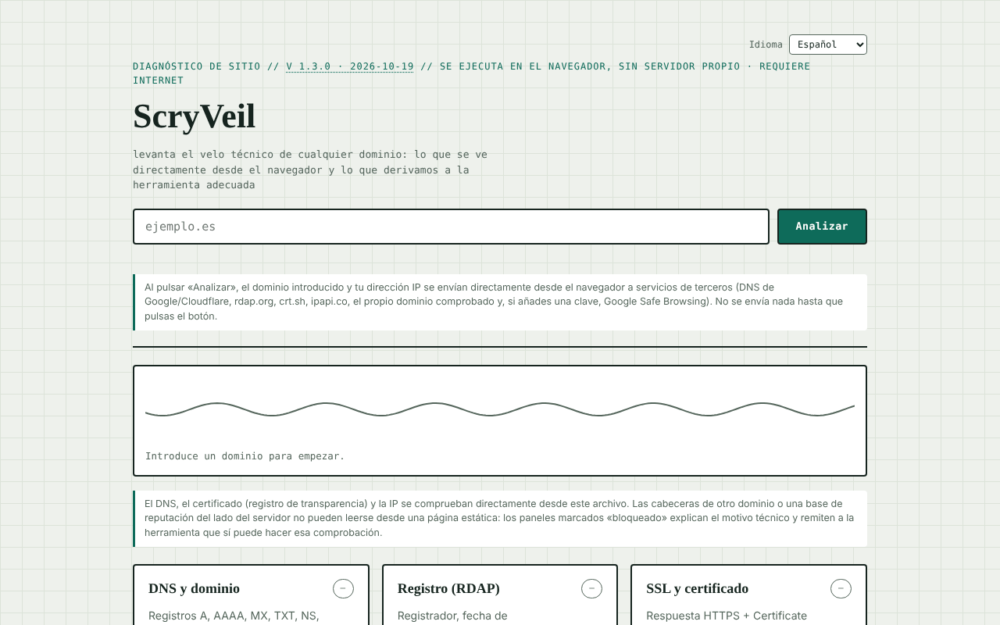

# ScryVeil

[English](README.md) · [Română](README.ro.md) · [Français](README.fr.md) · [Italiano](README.it.md) · **Español** · [Português](README.pt.md) · [Deutsch](README.de.md) · [Magyar](README.hu.md)

**Versión:** 1.3.3 · **Última actualización:** 2026-10-22

Idiomas de la interfaz: **Română, English, Français, Italiano, Español, Português (PT), Deutsch, Magyar**

Diagnóstico de seguridad para cualquier sitio web, ejecutado directamente desde el navegador: DNS, RDAP, certificado, cabeceras, IP y reputación.

**Aplicación en línea:** https://chiuta.github.io/ScryVeil/

## Qué es

ScryVeil es una aplicación de un solo archivo (`index.html`) que «levanta el velo técnico» en torno a un dominio: introduces un dominio y la página ejecuta desde el navegador las comprobaciones posibles sin servidor propio. Lo que no se puede leer desde una página estática (las cabeceras de otro dominio, las bases de reputación del lado del servidor) se marca como «bloqueado», con la explicación técnica y enlaces a herramientas externas adecuadas, con el dominio rellenado automáticamente.

## Funciones

Seis paneles:

- **DNS y dominio** — registros A, AAAA, MX, TXT, NS, CNAME, SOA, CAA y señal DNSSEC.
- **Registro (RDAP)** — registrador, fecha de registro/vencimiento, servidores de nombres.
- **SSL y certificado** — respuesta HTTPS y Certificate Transparency (crt.sh).
- **Cabeceras de seguridad** — CSP, HSTS, X-Frame-Options, etc., solo si el dominio permite la lectura desde otro origen.
- **IP y alojamiento** — dirección IP, organización/ASN, ubicación aproximada.
- **Reputación y lista negra** — comprobación con Google Safe Browsing si introduces opcionalmente una clave API propia.

Además, un informe de texto local (copiar/descargar) y «Envíos externos» (se abren en una pestaña nueva, con el dominio rellenado): Sucuri SiteCheck, VirusTotal, Google Transparency, Qualys SSL Labs, securityheaders.com, Mozilla HTTP Observatory, Web-Check. Un indicador animado muestra el estado del análisis. La interfaz está en rumano.

## Guía de uso

1. Escribe el dominio en el campo «exemplu.ro» (no hacen falta más ajustes).
2. Pulsa «Scanează» (Analizar). El resumen bajo la cabecera muestra el estado general y cada panel recibe un estado (ok / advertencia / problema / bloqueado).
3. Lee cada panel; donde aparezca «bloqueado», usa el enlace a la herramienta externa en «Envíos externos».
4. Opcional: para el panel de reputación, pega una clave API de Google Safe Browsing en el campo correspondiente; la clave permanece solo en la memoria de la pestaña y no se guarda.
5. Para otro dominio, cambia el texto y pulsa de nuevo «Scanează».

## Privacidad y red

La aplicación **no es offline**: las comprobaciones requieren conexión y contactan con terceros directamente desde tu navegador. La propia página declara que no envía datos a un servidor propio y muestra, bajo el campo de análisis, qué datos salen y hacia quién (no se envía nada hasta que pulsas «Scanează»). Hosts contactados al pulsar «Scanează»:

- `dns.google` y `cloudflare-dns.com` (consultas DNS-over-HTTPS con el dominio introducido);
- `rdap.org` (datos de registro);
- `crt.sh` (transparencia de certificados);
- el propio dominio comprobado, por HTTPS (comprobación de accesibilidad y, donde el navegador lo permite, cabeceras);
- `ipapi.co` (organización/ubicación de la IP resuelta);
- `safebrowsing.googleapis.com`, solo si introduces una clave API.

Estos terceros reciben el dominio introducido y tu dirección IP. Los enlaces de «Envíos externos» solo se abren al hacer clic. No encontré en el código `localStorage`, `IndexedDB` ni cookies; la clave de Safe Browsing no se conserva.

## Limitaciones y uso responsable

Las comprobaciones usan solo fuentes públicas y peticiones habituales del navegador, pero los resultados son informativos y no constituyen una auditoría de seguridad completa; «bloqueado» significa que el navegador (CORS) no permite la lectura, no que el problema no exista. Usa la herramienta solo para dominios propios o para los que tengas el consentimiento del titular.

## Ejecución local / offline

Descarga `index.html` y ábrelo en un navegador. La interfaz carga sin internet, pero los análisis requieren internet.

## Historial / Changelog

### 1.3.3 — 2026-10-22

fff-kit 1.1.4: objetivos táctiles y tamaño mínimo de texto.

### 1.3.2 — 2026-10-22
- fff-kit 1.1.2: PBKDF2 con 600.000 iteraciones, protección anti-clickjacking

### 1.3.1 — 2026-10-22
- El informe exportado empieza ahora con una línea que nombra cada prueba no realizada y el motivo (bloqueada por CORS, requiere clave, no disponible), o indica que se ejecutaron todas.
- Etiqueta de transparencia corregida: el selector de idioma está declarado en la página, por lo que la etiqueta lista ahora los 8 idiomas de la interfaz en lugar de una lista vacía.
- Móvil: ningún texto por debajo de 12 px y áreas táctiles de al menos 24 px (WCAG 2.5.8).

- 1.2.0 — 2026-10-18: `#d=<dominio>` rellena previamente el campo (como `?d=`, pero el fragmento no llega al servidor); nada se analiza automáticamente. Lo usa el enlace desde SEOptimum.
- 1.1.0 — 2026-10-14: copia de seguridad y etiquetado de datos (fff-kit).

- 1.0.4 — 2026-10-12: la versión y la fecha de la última actualización se muestran en la aplicación
- El error de validación del dominio es ahora visible y accesible: el campo recibe el foco y `aria-invalid`, borde rojo, el mensaje se vincula mediante `aria-describedby` y se borra con la siguiente pulsación de tecla; un texto con espacios o caracteres especiales recibe el mensaje sobre caracteres no permitidos (ya no aparece la forma codificada `a%20b`).
- Tras cada análisis aparecen «Copiar el informe» y «Descargar informe .txt» (informe de texto generado localmente a partir de los paneles); sin conexión, «Scanează» muestra un mensaje claro en lugar de lanzar peticiones que fallarían.
- Tema oscuro automático (`prefers-color-scheme`), estilo de impresión para los resultados, relleno previo del dominio desde `?d=exemplu.ro` (sin análisis automático).
- CSP: `script-src` con hash SHA-256, sin `'unsafe-inline'` para scripts.
- El campo del dominio ahora valida la entrada: texto vacío, «localhost», direcciones IP, nombres sin punto o con caracteres no permitidos reciben un mensaje claro en `#formError`.
- Añadida una Content-Security-Policy (meta): sin fuentes externas de script/estilo/imágenes; `connect-src https:` es necesario porque la aplicación también consulta el dominio introducido por el usuario.
- El contenido principal está envuelto en `<main>`; axe-core: 0 infracciones a 1280 y 360 px.
- Sin resolver (limitación declarada): la aplicación solo funciona en línea.

## Licencia

MIT para el código y la estructura de la aplicación — véase el archivo `LICENSE`. Las posibles bibliotecas de terceros incluidas en el archivo conservan sus propias licencias.

## Autor

Alexio — Alexandru-Ionuț Chiuță, contacto: alexio@trom.tf.

## Resumen

ScryVeil es un verificador de seguridad de sitios web de un solo archivo, que se ejecuta en el navegador: registros DNS, datos de registro RDAP, transparencia de certificados, cabeceras HTTPS/de seguridad (cuando son legibles), información de IP/alojamiento y consultas opcionales a Google Safe Browsing, además de enlaces a escáneres externos. Las peticiones salen directamente de tu navegador hacia los DNS públicos (Google/Cloudflare), rdap.org, crt.sh, ipapi.co, el dominio analizado y, opcionalmente, Safe Browsing; no se almacena nada. Licencia: MIT (véase LICENSE).

Auditoría: 2026-10-10 — código verificado (los hosts contactados coinciden con la sección anterior; los datos de las respuestas se escapan o se insertan mediante textContent), accesibilidad (axe) y funcionamiento comprobados; añadida una advertencia de uso.
