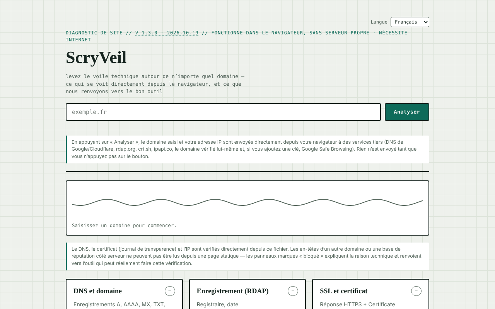

# ScryVeil

[English](README.md) · [Română](README.ro.md) · **Français** · [Italiano](README.it.md) · [Español](README.es.md) · [Português](README.pt.md) · [Deutsch](README.de.md) · [Magyar](README.hu.md)

**Version :** 1.3.0 · **Dernière mise à jour :** 2026-10-19

Langues de l'interface : **Română, English, Français, Italiano, Español, Português (PT), Deutsch, Magyar**

Diagnostic de sécurité pour n'importe quel site, exécuté directement depuis le navigateur : DNS, RDAP, certificat, en-têtes, IP et réputation.

**Application en ligne :** https://chiuta.github.io/ScryVeil/

## Présentation

ScryVeil est une application en un seul fichier (`index.html`) qui « lève le voile technique » autour d'un domaine : vous saisissez un domaine, et la page exécute depuis le navigateur toutes les vérifications possibles sans serveur propre. Ce qui ne peut pas être lu depuis une page statique (les en-têtes d'un autre domaine, les bases de réputation côté serveur) est marqué « bloqué », avec l'explication technique et des liens vers des outils externes adaptés, le domaine étant renseigné automatiquement.

## Fonctionnalités

Six panneaux :

- **DNS et domaine** — enregistrements A, AAAA, MX, TXT, NS, CNAME, SOA, CAA et signal DNSSEC.
- **Enregistrement (RDAP)** — registraire, date d'enregistrement/d'expiration, serveurs de noms.
- **SSL et certificat** — réponse HTTPS et Certificate Transparency (crt.sh).
- **En-têtes de sécurité** — CSP, HSTS, X-Frame-Options, etc., uniquement si le domaine autorise la lecture inter-origine.
- **IP et hébergement** — adresse IP, organisation/ASN, localisation approximative.
- **Réputation et liste noire** — vérification Google Safe Browsing si vous saisissez, en option, votre propre clé API.

S'y ajoutent un rapport texte local (copie/téléchargement) et des « Soumissions externes » (ouvertes dans un nouvel onglet, avec le domaine renseigné) : Sucuri SiteCheck, VirusTotal, Google Transparency, Qualys SSL Labs, securityheaders.com, Mozilla HTTP Observatory, Web-Check. Un indicateur animé montre l'état de l'analyse. L'interface est en roumain.

## Mode d'emploi

1. Saisissez le domaine dans le champ « exemplu.ro » (aucun autre réglage n'est nécessaire).
2. Appuyez sur « Scanează » (Analyser). Le résumé sous l'en-tête indique l'état général, et chaque panneau reçoit un état (ok / avertissement / problème / bloqué).
3. Lisez chaque panneau ; là où « bloqué » apparaît, utilisez le lien vers l'outil externe dans « Soumissions externes ».
4. En option : pour le panneau de réputation, collez une clé API Google Safe Browsing dans le champ dédié ; la clé reste uniquement en mémoire dans l'onglet et n'est pas enregistrée.
5. Pour un autre domaine, modifiez le texte et appuyez de nouveau sur « Scanează ».

## Confidentialité et réseau

L'application **n'est pas hors ligne** : les vérifications nécessitent une connexion et contactent des tiers directement depuis votre navigateur. La page déclare elle-même qu'elle n'envoie aucune donnée à un serveur propre et affiche, sous le champ d'analyse, quelles données partent et vers qui (rien n'est envoyé tant que vous n'appuyez pas sur « Scanează »). Hôtes contactés lorsque vous appuyez sur « Scanează » :

- `dns.google` et `cloudflare-dns.com` (requêtes DNS-over-HTTPS avec le domaine saisi) ;
- `rdap.org` (données d'enregistrement) ;
- `crt.sh` (transparence des certificats) ;
- le domaine vérifié lui-même, via HTTPS (contrôle d'accessibilité et, lorsque le navigateur le permet, en-têtes) ;
- `ipapi.co` (organisation/localisation pour l'IP résolue) ;
- `safebrowsing.googleapis.com`, uniquement si vous saisissez une clé API.

Ces tiers reçoivent le domaine saisi et votre adresse IP. Les liens des « Soumissions externes » ne s'ouvrent qu'au clic. Je n'ai trouvé dans le code ni `localStorage`, ni `IndexedDB`, ni cookies ; la clé Safe Browsing n'est pas conservée.

## Limites et usage responsable

Les vérifications n'utilisent que des sources publiques et des requêtes ordinaires du navigateur, mais les résultats sont indicatifs et ne constituent pas un audit de sécurité complet ; « bloqué » signifie que le navigateur (CORS) n'autorise pas la lecture, et non que le problème n'existe pas. N'utilisez l'outil que pour vos propres domaines ou pour des domaines dont le titulaire a donné son accord.

## Exécution locale / hors ligne

Téléchargez `index.html` et ouvrez-le dans un navigateur. L'interface se charge sans internet, mais les analyses nécessitent internet.

## Historique / Changelog

- 1.2.0 — 2026-10-18 : `#d=<domaine>` préremplit le champ (comme `?d=`, mais le fragment n'atteint pas le serveur) ; rien n'est analysé automatiquement. Utilisé par le lien depuis SEOptimum.
- 1.1.0 — 2026-10-14 : sauvegarde et étiquetage des données (fff-kit).

- 1.0.4 — 2026-10-12 : la version et la date de dernière mise à jour sont affichées dans l'application
- L'erreur de validation du domaine est désormais visible et accessible : le champ reçoit le focus et `aria-invalid`, une bordure rouge, le message est relié par `aria-describedby` et s'efface à la frappe suivante ; un texte contenant des espaces ou des caractères spéciaux reçoit le message sur les caractères non autorisés (la forme encodée `a%20b` n'apparaît plus).
- Après chaque analyse apparaissent « Copier le rapport » et « Télécharger le rapport .txt » (rapport texte généré localement à partir des panneaux) ; sans connexion, « Scanează » affiche un message clair au lieu de lancer des requêtes qui échoueraient.
- Thème sombre automatique (`prefers-color-scheme`), style d'impression pour les résultats, préremplissage du domaine depuis `?d=exemplu.ro` (sans analyse automatique).
- CSP : `script-src` sur un hachage SHA-256, sans `'unsafe-inline'` pour les scripts.
- Le champ du domaine valide désormais la saisie : texte vide, « localhost », adresses IP, noms sans point ou contenant des caractères non autorisés reçoivent un message clair dans `#formError`.
- Ajout d'une Content-Security-Policy (meta) : aucune source externe de script/style/image ; `connect-src https:` est nécessaire car l'application interroge aussi le domaine saisi par l'utilisateur.
- Le contenu principal est encadré par `<main>` ; axe-core : 0 violation à 1280 et 360 px.
- Non résolu (limite déclarée) : l'application ne fonctionne qu'en ligne.

## Licence

MIT pour le code et la structure de l'application — voir le fichier `LICENSE`. Les éventuelles bibliothèques tierces incluses dans le fichier conservent leurs propres licences.

## Auteur

Alexio — Alexandru-Ionuț Chiuță, contact : alexio@trom.tf.

## Résumé
ScryVeil est un vérificateur de sécurité de sites en un seul fichier, exécuté dans le navigateur : enregistrements DNS, données d'enregistrement RDAP, transparence des certificats, en-têtes HTTPS/de sécurité (lorsqu'ils sont lisibles), informations IP/hébergement et consultations Google Safe Browsing facultatives, plus des liens vers des scanners externes. Les requêtes partent directement de votre navigateur vers les DNS publics (Google/Cloudflare), rdap.org, crt.sh, ipapi.co, le domaine analysé et, en option, Safe Browsing ; rien n'est stocké. Licence : MIT (voir LICENSE).

Audit : 2026-10-10 — code vérifié (les hôtes contactés correspondent à la section ci-dessus ; les données des réponses sont échappées ou insérées via textContent), accessibilité (axe) et fonctionnement contrôlés ; avertissement d'utilisation ajouté.
