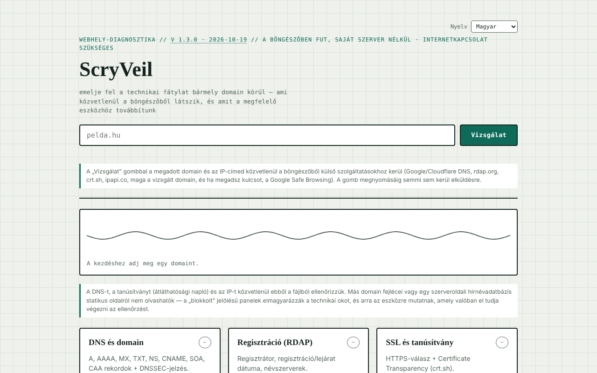

# ScryVeil

[English](README.md) · [Română](README.ro.md) · [Français](README.fr.md) · [Italiano](README.it.md) · [Español](README.es.md) · [Português](README.pt.md) · [Deutsch](README.de.md) · **Magyar**

**Verzió:** 1.3.6 · **Utolsó frissítés:** 2026-10-26

A felület nyelvei: **Română, English, Français, Italiano, Español, Português (PT), Deutsch, Magyar**

Biztonsági diagnosztika bármely weboldalhoz, közvetlenül a böngészőből futtatva: DNS, RDAP, tanúsítvány, fejlécek, IP és hírnév.

**Online alkalmazás:** https://chiuta.github.io/ScryVeil/

## Mi ez

A ScryVeil egyfájlos alkalmazás (`index.html`), amely „fellebbenti a technikai fátylat” egy domain körül: megadsz egy domaint, és az oldal a böngészőből lefuttatja mindazokat az ellenőrzéseket, amelyek saját szerver nélkül lehetségesek. Ami statikus oldalról nem olvasható (egy másik domain fejlécei, a szerveroldali hírnévadatbázisok), azt „blokkolt” jelzéssel látja el, a technikai magyarázattal és a megfelelő külső eszközökre mutató hivatkozásokkal, a domain automatikus kitöltésével.

## Funkciók

Hat panel:

- **DNS és domain** — A, AAAA, MX, TXT, NS, CNAME, SOA, CAA rekordok és DNSSEC-jelzés.
- **Regisztráció (RDAP)** — regisztrátor, regisztrációs/lejárati dátum, névszerverek.
- **SSL és tanúsítvány** — HTTPS-válasz és Certificate Transparency (crt.sh).
- **Biztonsági fejlécek** — CSP, HSTS, X-Frame-Options stb., csak ha a domain engedi a más eredetű olvasást.
- **IP és tárhely** — IP-cím, szervezet/ASN, hozzávetőleges földrajzi hely.
- **Hírnév és feketelista** — Google Safe Browsing-ellenőrzés, ha opcionálisan megadsz saját API-kulcsot.

Ezen felül helyi szöveges jelentés (másolás/letöltés) és „Külső beküldések” (új lapon nyílnak meg, kitöltött domainnel): Sucuri SiteCheck, VirusTotal, Google Transparency, Qualys SSL Labs, securityheaders.com, Mozilla HTTP Observatory, Web-Check. Animált jelző mutatja a vizsgálat állapotát. A felület román nyelvű.

## Használati útmutató

1. Írd be a domaint az „exemplu.ro” mezőbe (más beállításra nincs szükség).
2. Nyomd meg a „Scanează” (Vizsgálat) gombot. A fejléc alatti összegzés az általános állapotot mutatja, és minden panel kap egy állapotot (rendben / figyelmeztetés / probléma / blokkolt).
3. Olvasd el az egyes paneleket; ahol „blokkolt” jelenik meg, használd a „Külső beküldések” alatti hivatkozást a külső eszközhöz.
4. Opcionális: a hírnév panelhez illessz be egy Google Safe Browsing API-kulcsot a kijelölt mezőbe; a kulcs csak a lap memóriájában marad, és nem kerül mentésre.
5. Másik domainhez írd át a szöveget, és nyomd meg újra a „Scanează” gombot.

## Adatvédelem és hálózat

Az alkalmazás **nem offline**: az ellenőrzésekhez kapcsolat kell, és közvetlenül a böngésződből veszik fel a kapcsolatot harmadik felekkel. Maga az oldal kijelenti, hogy nem küld adatot saját szervernek, és a vizsgálati mező alatt megjeleníti, milyen adatok kihez kerülnek (a „Scanează” megnyomásáig semmi nem kerül elküldésre). A „Scanează” megnyomásakor megkeresett gazdagépek:

- `dns.google` és `cloudflare-dns.com` (DNS-over-HTTPS lekérdezések a megadott domainnel);
- `rdap.org` (regisztrációs adatok);
- `crt.sh` (tanúsítvány-átláthatóság);
- maga az ellenőrzött domain HTTPS-en keresztül (elérhetőségi vizsgálat, és ahol a böngésző engedi, fejlécek);
- `ipapi.co` (szervezet/helyszín a feloldott IP-hez);
- `safebrowsing.googleapis.com`, csak ha API-kulcsot adsz meg.

Ezek a harmadik felek megkapják a megadott domaint és az IP-címedet. A „Külső beküldések” hivatkozásai csak kattintásra nyílnak meg. A kódban nem találtam `localStorage`-t, `IndexedDB`-t vagy sütiket; a Safe Browsing-kulcs nem kerül tartós tárolásra.

## Korlátok és felelős használat

Az ellenőrzések csak nyilvános forrásokat és szokásos böngészőkéréseket használnak, de az eredmények tájékoztató jellegűek, és nem minősülnek teljes biztonsági auditnak; a „blokkolt” azt jelenti, hogy a böngésző (CORS) nem engedi az olvasást, nem azt, hogy a probléma nem létezik. Az eszközt csak saját domainekhez, vagy olyanokhoz használd, amelyekre a tulajdonos hozzájárulásával rendelkezel.

## Helyi futtatás / offline

Töltsd le az `index.html` fájlt, és nyisd meg böngészőben. A felület internet nélkül is betöltődik, de a vizsgálatokhoz internet kell.

## Előzmények / Changelog

### 1.3.3 — 2026-10-22

fff-kit 1.1.4: érintési célok és minimális szövegméret.

### 1.3.2 — 2026-10-22
- fff-kit 1.1.2: PBKDF2 600 000 iterációval, clickjacking elleni védelem

### 1.3.1 — 2026-10-22
- A exportált jelentés mostantól egy sorral kezdődik, amely megnevezi minden el nem végzett tesztet és az okát (CORS blokkolta, kulcs szükséges, nem elérhető), vagy jelzi, hogy minden teszt lefutott.
- Javított átláthatósági címke: a nyelvválasztó az oldalban deklarált, így a címke most a felület 8 nyelvét sorolja fel üres lista helyett.
- Mobil: nincs 12 px alatti szöveg, az érintési célpontok legalább 24 px-esek (WCAG 2.5.8).

- 1.2.0 — 2026-10-18: a `#d=<domain>` előre kitölti a mezőt (mint a `?d=`, de a töredék nem jut el a szerverig); semmi sem kerül automatikusan vizsgálatra. A SEOptimumból érkező hivatkozás használja.
- 1.1.0 — 2026-10-14: adatmentés és adatcímkézés (fff-kit).

- 1.0.4 — 2026-10-12: a verzió és az utolsó frissítés dátuma megjelenik az alkalmazásban
- A domain-érvényesítési hiba mostantól látható és hozzáférhető: a mező fókuszt és `aria-invalid` attribútumot kap, piros keretet, az üzenet `aria-describedby` útján kapcsolódik, és a következő billentyűleütésre törlődik; a szóközt vagy különleges karaktert tartalmazó szöveg a nem megengedett karakterekről szóló üzenetet kapja (a kódolt `a%20b` alak már nem jelenik meg).
- Minden vizsgálat után megjelenik a „Jelentés másolása” és a „.txt jelentés letöltése” (a panelekből helyben előállított szöveges jelentés); kapcsolat nélkül a „Scanează” érthető üzenetet ad ahelyett, hogy kudarcra ítélt kéréseket indítana.
- Automatikus sötét téma (`prefers-color-scheme`), nyomtatási stílus az eredményekhez, a domain előzetes kitöltése a `?d=exemplu.ro` paraméterből (automatikus vizsgálat nélkül).
- CSP: `script-src` SHA-256 hash-sel, `'unsafe-inline'` nélkül a szkriptekhez.
- A domain mező mostantól ellenőrzi a bevitelt: üres szöveg, „localhost”, IP-címek, pont nélküli vagy nem megengedett karaktereket tartalmazó nevek érthető üzenetet kapnak a `#formError` elemben.
- Content-Security-Policy (meta) hozzáadva: nincsenek külső szkript-/stílus-/képforrások; a `connect-src https:` azért szükséges, mert az alkalmazás a felhasználó által megadott domaint is lekérdezi.
- A fő tartalom `<main>` elembe van foglalva; axe-core: 0 szabálysértés 1280 és 360 px-en.
- Megoldatlan (vállalt korlát): az alkalmazás csak online működik.

## Licenc

MIT az alkalmazás kódjára és szerkezetére — lásd a `LICENSE` fájlt. A fájlban esetleg szereplő harmadik fél által készített könyvtárak megtartják saját licencüket.

## Szerző

Alexio — Alexandru-Ionuț Chiuță, kapcsolat: alexio@trom.tf.

## Összefoglaló
A ScryVeil egyfájlos, böngészőben futó weboldal-biztonsági ellenőrző: DNS-rekordok, RDAP-regisztrációs adatok, tanúsítvány-átláthatóság, HTTPS-/biztonsági fejlécek (ha olvashatók), IP-/tárhelyinformációk és opcionális Google Safe Browsing-lekérdezések, valamint hivatkozások külső vizsgálókhoz. A kérések közvetlenül a böngésződből indulnak a nyilvános DNS-ek (Google/Cloudflare), az rdap.org, a crt.sh, az ipapi.co, a vizsgált domain és opcionálisan a Safe Browsing felé; semmi nem kerül tárolásra. Licenc: MIT (lásd LICENSE).

Audit: 2026-10-10 — a kód ellenőrizve (a megkeresett gazdagépek egyeznek a fenti szakasszal; a válaszok adatai escape-eltek vagy textContent útján kerülnek beillesztésre), a hozzáférhetőség (axe) és a működés ellenőrizve; használati figyelmeztetés hozzáadva.
