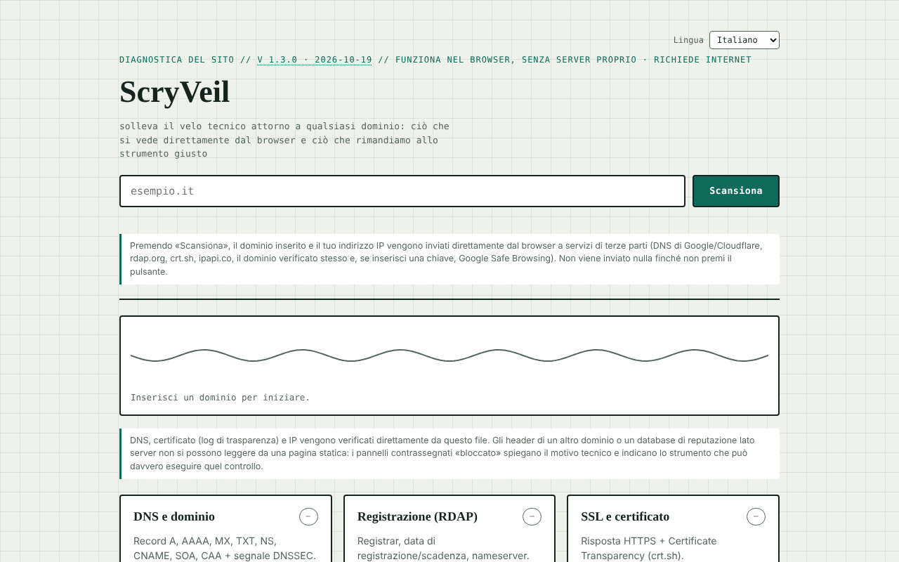

# ScryVeil

[English](README.md) · [Română](README.ro.md) · [Français](README.fr.md) · **Italiano** · [Español](README.es.md) · [Português](README.pt.md) · [Deutsch](README.de.md) · [Magyar](README.hu.md)

**Versione:** 1.3.4 · **Ultimo aggiornamento:** 2026-10-23

Lingue dell'interfaccia: **Română, English, Français, Italiano, Español, Português (PT), Deutsch, Magyar**

Diagnostica di sicurezza per qualsiasi sito, eseguita direttamente dal browser: DNS, RDAP, certificato, header, IP e reputazione.

**App online:** https://chiuta.github.io/ScryVeil/

## Che cos'è

ScryVeil è un'applicazione a file singolo (`index.html`) che «solleva il velo tecnico» attorno a un dominio: si inserisce un dominio e la pagina esegue dal browser tutte le verifiche possibili senza un server proprio. Ciò che non si può leggere da una pagina statica (gli header di un altro dominio, i database di reputazione lato server) è contrassegnato come «bloccato», con la spiegazione tecnica e i link a strumenti esterni adatti, con il dominio compilato automaticamente.

## Funzionalità

Sei pannelli:

- **DNS e dominio** — record A, AAAA, MX, TXT, NS, CNAME, SOA, CAA e segnale DNSSEC.
- **Registrazione (RDAP)** — registrar, data di registrazione/scadenza, nameserver.
- **SSL e certificato** — risposta HTTPS e Certificate Transparency (crt.sh).
- **Header di sicurezza** — CSP, HSTS, X-Frame-Options ecc., solo se il dominio consente la lettura cross-origin.
- **IP e hosting** — indirizzo IP, organizzazione/ASN, posizione approssimativa.
- **Reputazione e blacklist** — verifica Google Safe Browsing se si inserisce facoltativamente una chiave API propria.

In più, un report testuale locale (copia/download) e «Invii esterni» (si aprono in una nuova scheda, con il dominio compilato): Sucuri SiteCheck, VirusTotal, Google Transparency, Qualys SSL Labs, securityheaders.com, Mozilla HTTP Observatory, Web-Check. Un indicatore animato mostra lo stato della scansione. L'interfaccia è in rumeno.

## Guida all'uso

1. Scrivi il dominio nel campo «exemplu.ro» (non servono altre impostazioni).
2. Premi «Scanează» (Scansiona). Il riepilogo sotto l'intestazione mostra lo stato generale e ogni pannello riceve uno stato (ok / avviso / problema / bloccato).
3. Leggi ogni pannello; dove compare «bloccato», usa il link allo strumento esterno in «Invii esterni».
4. Facoltativo: per il pannello della reputazione, incolla una chiave API Google Safe Browsing nel campo dedicato; la chiave resta solo nella memoria della scheda e non viene salvata.
5. Per un altro dominio, cambia il testo e premi di nuovo «Scanează».

## Privacy e rete

L'applicazione **non è offline**: le verifiche richiedono una connessione e contattano terze parti direttamente dal tuo browser. La pagina stessa dichiara di non inviare dati a un server proprio e mostra, sotto il campo di scansione, quali dati partono e verso chi (non viene inviato nulla finché non premi «Scanează»). Host contattati alla pressione di «Scanează»:

- `dns.google` e `cloudflare-dns.com` (query DNS-over-HTTPS con il dominio inserito);
- `rdap.org` (dati di registrazione);
- `crt.sh` (certificate transparency);
- il dominio verificato stesso, via HTTPS (controllo di raggiungibilità e, dove il browser lo consente, header);
- `ipapi.co` (organizzazione/posizione per l'IP risolto);
- `safebrowsing.googleapis.com`, solo se inserisci una chiave API.

Queste terze parti ricevono il dominio inserito e il tuo indirizzo IP. I link in «Invii esterni» si aprono solo al clic. Nel codice non ho trovato `localStorage`, `IndexedDB` o cookie; la chiave Safe Browsing non viene conservata.

## Limiti e uso responsabile

Le verifiche usano solo fonti pubbliche e richieste ordinarie del browser, ma i risultati sono informativi e non costituiscono un audit di sicurezza completo; «bloccato» significa che il browser (CORS) non consente la lettura, non che il problema non esista. Usa lo strumento solo per domini propri o per cui hai il consenso del titolare.

## Esecuzione locale / offline

Scarica `index.html` e aprilo in un browser. L'interfaccia si carica senza internet, ma le scansioni richiedono internet.

## Cronologia / Changelog

### 1.3.3 — 2026-10-22

fff-kit 1.1.4: target touch e dimensione minima del testo.

### 1.3.2 — 2026-10-22
- fff-kit 1.1.2: PBKDF2 con 600.000 iterazioni, protezione anti-clickjacking

### 1.3.1 — 2026-10-22
- Il report esportato inizia ora con una riga che indica ogni test non eseguito e il motivo (bloccato da CORS, chiave richiesta, non disponibile) oppure precisa che tutti i test sono stati eseguiti.
- Etichetta di trasparenza corretta: il selettore della lingua è dichiarato nella pagina, quindi l'etichetta elenca ora le 8 lingue dell'interfaccia invece di un elenco vuoto.
- Mobile: nessun testo sotto i 12 px e aree tattili di almeno 24 px (WCAG 2.5.8).

- 1.2.0 — 2026-10-18: `#d=<dominio>` precompila il campo (come `?d=`, ma il frammento non arriva al server); nulla viene scansionato automaticamente. Usato dal link di SEOptimum.
- 1.1.0 — 2026-10-14: backup ed etichettatura dei dati (fff-kit).

- 1.0.4 — 2026-10-12: la versione e la data dell'ultimo aggiornamento sono mostrate nell'app
- L'errore di validazione del dominio è ora visibile e accessibile: il campo riceve il focus e `aria-invalid`, un bordo rosso, il messaggio è collegato tramite `aria-describedby` e si cancella alla battuta successiva; un testo con spazi o caratteri speciali riceve il messaggio sui caratteri non consentiti (la forma codificata `a%20b` non appare più).
- Dopo ogni scansione compaiono «Copia il report» e «Scarica report .txt» (report testuale generato localmente dai pannelli); senza connessione, «Scanează» mostra un messaggio chiaro invece di avviare richieste destinate a fallire.
- Tema scuro automatico (`prefers-color-scheme`), stile di stampa per i risultati, precompilazione del dominio da `?d=exemplu.ro` (senza scansione automatica).
- CSP: `script-src` su hash SHA-256, senza `'unsafe-inline'` per gli script.
- Il campo del dominio ora convalida l'input: testo vuoto, «localhost», indirizzi IP, nomi senza punto o con caratteri non consentiti ricevono un messaggio chiaro in `#formError`.
- Aggiunta una Content-Security-Policy (meta): nessuna sorgente esterna di script/stili/immagini; `connect-src https:` è necessario perché l'applicazione interroga anche il dominio inserito dall'utente.
- Il contenuto principale è racchiuso in `<main>`; axe-core: 0 violazioni a 1280 e 360 px.
- Irrisolto (limite dichiarato): l'applicazione funziona solo online.

## Licenza

MIT per il codice e la struttura dell'applicazione — vedi il file `LICENSE`. Le eventuali librerie di terze parti incluse nel file mantengono le proprie licenze.

## Autore

Alexio — Alexandru-Ionuț Chiuță, contatto: alexio@trom.tf.

## Riepilogo
ScryVeil è un verificatore di sicurezza dei siti a file singolo, eseguito nel browser: record DNS, dati di registrazione RDAP, certificate transparency, header HTTPS/di sicurezza (quando leggibili), informazioni su IP/hosting e consultazioni Google Safe Browsing facoltative, più link a scanner esterni. Le richieste partono direttamente dal tuo browser verso i DNS pubblici (Google/Cloudflare), rdap.org, crt.sh, ipapi.co, il dominio scansionato e, facoltativamente, Safe Browsing; nulla viene memorizzato. Licenza: MIT (vedi LICENSE).

Audit: 2026-10-10 — codice verificato (gli host contattati corrispondono alla sezione precedente; i dati delle risposte sono sottoposti a escape o inseriti tramite textContent), accessibilità (axe) e funzionamento controllati; aggiunto un avviso d'uso.
