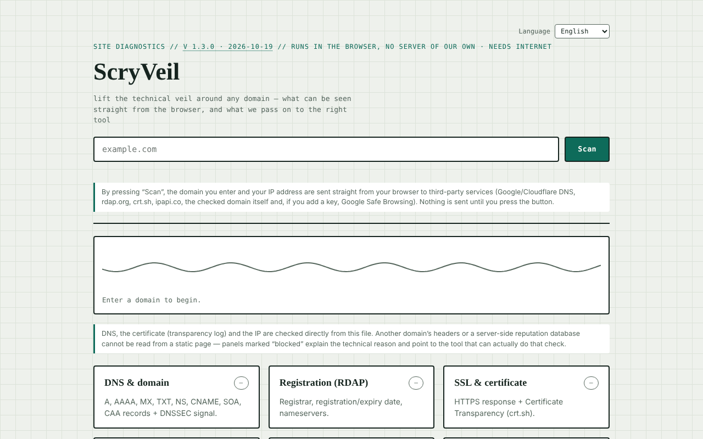

# ScryVeil

**English** · [Română](README.ro.md) · [Français](README.fr.md) · [Italiano](README.it.md) · [Español](README.es.md) · [Português](README.pt.md) · [Deutsch](README.de.md) · [Magyar](README.hu.md)

**Version:** 1.3.4 · **Last updated:** 2026-10-23

Interface languages: **Română, English, Français, Italiano, Español, Português (PT), Deutsch, Magyar**

Security diagnostics for any website, run directly from the browser: DNS, RDAP, certificate, headers, IP and reputation.

**Live app:** https://chiuta.github.io/ScryVeil/

## What it is

ScryVeil is a single-file application (`index.html`) that "lifts the technical veil" around a domain: you enter a domain, and the page runs from your browser every check that is possible without a server of its own. Whatever cannot be read from a static page (another domain's headers, server-side reputation databases) is marked "blocked", with the technical explanation and links to suitable external tools, with the domain filled in automatically.

## Features

Six panels:

- **DNS & domain** — A, AAAA, MX, TXT, NS, CNAME, SOA, CAA records and a DNSSEC signal.
- **Registration (RDAP)** — registrar, registration/expiry date, nameservers.
- **SSL & certificate** — HTTPS response and Certificate Transparency (crt.sh).
- **Security headers** — CSP, HSTS, X-Frame-Options, etc., only if the domain allows cross-origin reading.
- **IP & hosting** — IP address, organization/ASN, approximate location.
- **Reputation & blacklist** — Google Safe Browsing check if you optionally enter your own API key.

Plus a local text report (copy/download) and "External submissions" (opened in a new tab, with the domain filled in): Sucuri SiteCheck, VirusTotal, Google Transparency, Qualys SSL Labs, securityheaders.com, Mozilla HTTP Observatory, Web-Check. An animated indicator shows the scan status. The interface is in Romanian.

## User guide

1. Type the domain in the "exemplu.ro" field (no other settings needed).
2. Press "Scanează" (Scan). The summary under the header shows the overall status, and each panel gets a status (ok / warning / problem / blocked).
3. Read each panel; where "blocked" appears, use the link to the external tool in "External submissions".
4. Optional: for the reputation panel, paste a Google Safe Browsing API key into the dedicated field; the key stays only in the tab's memory and is not saved.
5. For another domain, change the text and press "Scanează" again.

## Privacy and network

The application **is not offline**: the checks need a connection and contact third parties directly from your browser. The page itself states that it sends no data to a server of its own and shows, under the scan field, what data leaves and to whom (nothing is sent until you press "Scanează"). Hosts contacted when you press "Scanează":

- `dns.google` and `cloudflare-dns.com` (DNS-over-HTTPS queries with the entered domain);
- `rdap.org` (registration data);
- `crt.sh` (certificate transparency);
- the checked domain itself, over HTTPS (reachability check and, where the browser allows, headers);
- `ipapi.co` (organization/location for the resolved IP);
- `safebrowsing.googleapis.com`, only if you enter an API key.

These third parties receive the entered domain and your IP address. The links under "External submissions" open only on click. I did not find `localStorage`, `IndexedDB` or cookies in the code; the Safe Browsing key is not persisted.

## Limitations and responsible use

The checks use only public sources and ordinary browser requests, but the results are informational and do not constitute a full security audit; "blocked" means the browser (CORS) does not allow reading, not that the problem does not exist. Use the tool only for your own domains or domains for which you have the owner's consent.

## Running locally / offline

Download `index.html` and open it in a browser. The interface loads without internet, but scans require internet.

## History / Changelog

### 1.3.3 — 2026-10-22

fff-kit 1.1.4: touch targets and minimum text size.

### 1.3.2 — 2026-10-22
- fff-kit 1.1.2: PBKDF2 600,000 iterations, anti-clickjacking protection

### 1.3.1 — 2026-10-22
- The exported report now starts with a line naming every test that was not performed and why (blocked by CORS, key required, unavailable), or states that all tests ran.
- Transparency label fixed: the language selector is declared in the page, so the label now lists the 8 interface languages instead of an empty list.
- Mobile: no text below 12 px and touch targets of at least 24 px (WCAG 2.5.8).

- 1.2.0 — 2026-10-18: `#d=<domain>` pre-fills the field (like `?d=`, but the fragment never reaches the server); nothing is scanned automatically. Used by the link from SEOptimum.
- 1.1.0 — 2026-10-14: Backup and data labelling (fff-kit).

- 1.0.4 — 2026-10-12: the version and the last-updated date are shown in the app
- The domain validation error is now visible and accessible: the field receives focus and `aria-invalid`, a red border, the message is linked through `aria-describedby` and is cleared on the next keystroke; text with spaces or special characters gets the message about disallowed characters (the encoded form `a%20b` no longer appears).
- After each scan, "Copy report" and "Download .txt report" appear (a text report generated locally from the panels); with no connection, "Scan" shows a clear message instead of starting requests that would fail.
- Automatic dark theme (`prefers-color-scheme`), print style for results, domain prefill from `?d=exemplu.ro` (no automatic scan).
- CSP: `script-src` on a SHA-256 hash, without `'unsafe-inline'` for scripts.
- The domain field now validates input: empty text, "localhost", IP addresses, names without a dot or with disallowed characters get a clear message in `#formError`.
- Added a Content-Security-Policy (meta): no external script/style/image sources; `connect-src https:` is needed because the application also queries the domain entered by the user.
- The main content is wrapped in `<main>`; axe-core: 0 violations at 1280 and 360 px.
- Unresolved (declared limitation): the application works only online.

## License

MIT for the application's code and structure — see the `LICENSE` file. Any third-party libraries included in the file keep their own licenses.

## Author

Alexio — Alexandru-Ionuț Chiuță, contact: alexio@trom.tf.

## English summary

ScryVeil is a single-file browser-based site security checker: DNS records, RDAP registration data, certificate transparency, HTTPS/security headers (when readable), IP/hosting info and optional Google Safe Browsing lookups, plus links to external scanners. Requests go straight from your browser to public DNS (Google/Cloudflare), rdap.org, crt.sh, ipapi.co, the scanned domain and optionally Safe Browsing; nothing is stored. License: MIT (see LICENSE).

Audit: 2026-10-10 — code verified (the hosts contacted match the section above; data from responses is escaped or inserted via textContent), accessibility (axe) and functionality checked; a usage warning was added.
