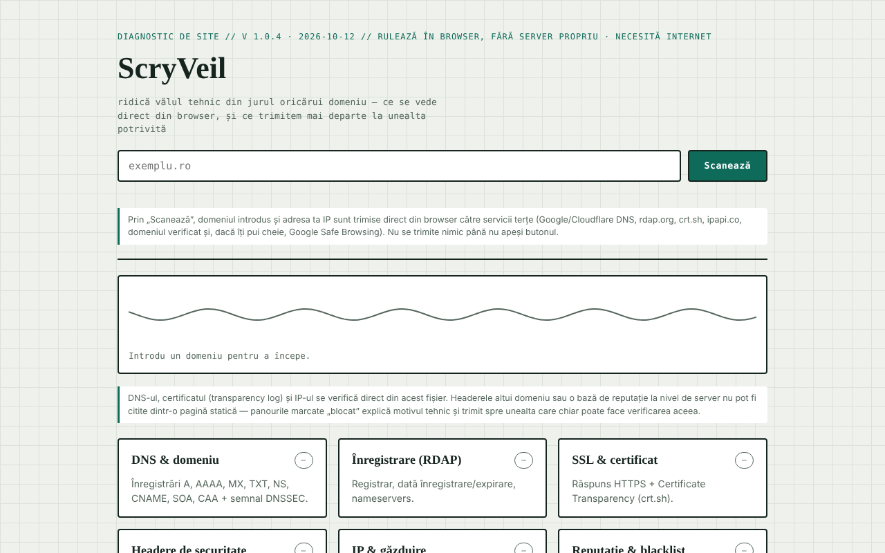

# ScryVeil

[English](README.md) · [Română](README.ro.md) · [Français](README.fr.md) · [Italiano](README.it.md) · [Español](README.es.md) · **Português** · [Deutsch](README.de.md) · [Magyar](README.hu.md)

**Versão:** 1.3.0 · **Última atualização:** 2026-10-19

Idiomas da interface: **Română, English, Français, Italiano, Español, Português (PT), Deutsch, Magyar**

Diagnóstico de segurança para qualquer site, executado diretamente a partir do navegador: DNS, RDAP, certificado, cabeçalhos, IP e reputação.

**Aplicação online:** https://chiuta.github.io/ScryVeil/

## O que é

O ScryVeil é uma aplicação de ficheiro único (`index.html`) que «levanta o véu técnico» em torno de um domínio: introduz-se um domínio e a página executa, a partir do navegador, as verificações possíveis sem servidor próprio. O que não pode ser lido a partir de uma página estática (os cabeçalhos de outro domínio, as bases de reputação do lado do servidor) é assinalado como «bloqueado», com a explicação técnica e ligações para ferramentas externas adequadas, com o domínio preenchido automaticamente.

## Funcionalidades

Seis painéis:

- **DNS e domínio** — registos A, AAAA, MX, TXT, NS, CNAME, SOA, CAA e sinal DNSSEC.
- **Registo (RDAP)** — registador, data de registo/expiração, servidores de nomes.
- **SSL e certificado** — resposta HTTPS e Certificate Transparency (crt.sh).
- **Cabeçalhos de segurança** — CSP, HSTS, X-Frame-Options, etc., apenas se o domínio permitir a leitura entre origens.
- **IP e alojamento** — endereço IP, organização/ASN, localização aproximada.
- **Reputação e lista negra** — verificação Google Safe Browsing se introduzir, opcionalmente, uma chave API própria.

Além disso, um relatório de texto local (copiar/transferir) e «Envios externos» (abrem num novo separador, com o domínio preenchido): Sucuri SiteCheck, VirusTotal, Google Transparency, Qualys SSL Labs, securityheaders.com, Mozilla HTTP Observatory, Web-Check. Um indicador animado mostra o estado da análise. A interface está em romeno.

## Manual de utilização

1. Escreva o domínio no campo «exemplu.ro» (não são necessárias outras definições).
2. Prima «Scanează» (Analisar). O resumo por baixo do cabeçalho mostra o estado geral e cada painel recebe um estado (ok / aviso / problema / bloqueado).
3. Leia cada painel; onde aparecer «bloqueado», utilize a ligação para a ferramenta externa em «Envios externos».
4. Opcional: para o painel de reputação, cole uma chave API do Google Safe Browsing no campo próprio; a chave permanece apenas na memória do separador e não é guardada.
5. Para outro domínio, altere o texto e prima novamente «Scanează».

## Privacidade e rede

A aplicação **não é offline**: as verificações exigem ligação e contactam terceiros diretamente a partir do seu navegador. A própria página declara que não envia dados para um servidor próprio e mostra, por baixo do campo de análise, que dados saem e para quem (nada é enviado até premir «Scanează»). Anfitriões contactados ao premir «Scanează»:

- `dns.google` e `cloudflare-dns.com` (consultas DNS-over-HTTPS com o domínio introduzido);
- `rdap.org` (dados de registo);
- `crt.sh` (transparência de certificados);
- o próprio domínio verificado, por HTTPS (verificação de acessibilidade e, onde o navegador o permitir, cabeçalhos);
- `ipapi.co` (organização/localização do IP resolvido);
- `safebrowsing.googleapis.com`, apenas se introduzir uma chave API.

Estes terceiros recebem o domínio introduzido e o seu endereço IP. As ligações de «Envios externos» só se abrem ao clicar. Não encontrei no código `localStorage`, `IndexedDB` nem cookies; a chave do Safe Browsing não é persistida.

## Limitações e utilização responsável

As verificações usam apenas fontes públicas e pedidos habituais do navegador, mas os resultados são informativos e não constituem uma auditoria de segurança completa; «bloqueado» significa que o navegador (CORS) não permite a leitura, não que o problema não exista. Utilize a ferramenta apenas para domínios próprios ou para os quais tenha o consentimento do titular.

## Execução local / offline

Transfira `index.html` e abra-o num navegador. A interface carrega sem internet, mas as análises exigem internet.

## Histórico / Changelog

- 1.2.0 — 2026-10-18: `#d=<domínio>` preenche previamente o campo (como `?d=`, mas o fragmento não chega ao servidor); nada é analisado automaticamente. Usado pela ligação a partir do SEOptimum.
- 1.1.0 — 2026-10-14: cópia de segurança e etiquetagem de dados (fff-kit).

- 1.0.4 — 2026-10-12: a versão e a data da última atualização são apresentadas na aplicação
- O erro de validação do domínio é agora visível e acessível: o campo recebe o foco e `aria-invalid`, contorno vermelho, a mensagem é ligada por `aria-describedby` e apaga-se na tecla seguinte; um texto com espaços ou carateres especiais recebe a mensagem sobre carateres não permitidos (a forma codificada `a%20b` já não aparece).
- Após cada análise surgem «Copiar o relatório» e «Transferir relatório .txt» (relatório de texto gerado localmente a partir dos painéis); sem ligação, «Scanează» mostra uma mensagem clara em vez de iniciar pedidos que falhariam.
- Tema escuro automático (`prefers-color-scheme`), estilo de impressão para os resultados, preenchimento prévio do domínio a partir de `?d=exemplu.ro` (sem análise automática).
- CSP: `script-src` com hash SHA-256, sem `'unsafe-inline'` para scripts.
- O campo do domínio passa a validar a entrada: texto vazio, «localhost», endereços IP, nomes sem ponto ou com carateres não permitidos recebem uma mensagem clara em `#formError`.
- Adicionada uma Content-Security-Policy (meta): sem fontes externas de script/estilo/imagens; `connect-src https:` é necessário porque a aplicação consulta também o domínio introduzido pelo utilizador.
- O conteúdo principal está envolvido em `<main>`; axe-core: 0 violações a 1280 e 360 px.
- Por resolver (limitação declarada): a aplicação só funciona online.

## Licença

MIT para o código e a estrutura da aplicação — veja o ficheiro `LICENSE`. As eventuais bibliotecas de terceiros incluídas no ficheiro mantêm as suas próprias licenças.

## Autor

Alexio — Alexandru-Ionuț Chiuță, contacto: alexio@trom.tf.

## Resumo em inglês

O ScryVeil é um verificador de segurança de sites de ficheiro único, executado no navegador: registos DNS, dados de registo RDAP, transparência de certificados, cabeçalhos HTTPS/de segurança (quando legíveis), informações de IP/alojamento e consultas opcionais ao Google Safe Browsing, além de ligações para analisadores externos. Os pedidos saem diretamente do seu navegador para os DNS públicos (Google/Cloudflare), rdap.org, crt.sh, ipapi.co, o domínio analisado e, opcionalmente, o Safe Browsing; nada é armazenado. Licença: MIT (veja LICENSE).

Auditoria: 2026-10-10 — código verificado (os anfitriões contactados correspondem à secção acima; os dados das respostas são escapados ou inseridos através de textContent), acessibilidade (axe) e funcionamento verificados; acrescentado um aviso de utilização.
